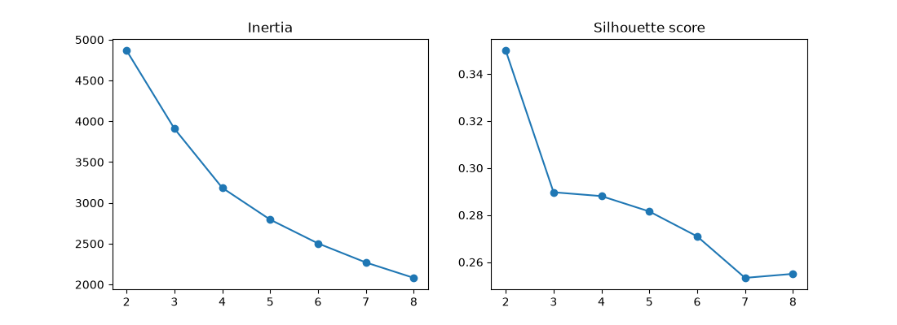

# messy-data-eda
Practice real-world data cleaning on a genuinely messy dataset, then use k-means and PCA to explore it.

## Source
**University of Turku, collected 2017–2019 (Zenodo record "Information skills of Finnish basic education teachers")**. Kaggle copy: thedevastator/finnish-basic-education-teacher-ict-skills-and-u.

## Three messy-data problems
- **Hidden missing values**. df.isnull().sum() reports zero missing values, but that's misleading. Three columns are stored as text because blanks are encoded as a single space " ", not as real NaN. Roughly 46% of rows are blank for Self_efficacy and for Inservice_training.
- **The missingness has a pattern**. The two columns are blank together for most of those rows, and those teachers differ from the rest (e.g. older, lower information-skills scores). That suggests these questions weren't answered or asked for a whole subgroup (the cause is likely structural, such as a different questionnaire version or round, but verify in the source documentation). It is not random noise, so filling blanks with the median would be inventing data for nearly half the sample.
- **29 exact duplicate rows**, with no ID column to tell whether they're double submissions or coincidentally identical teachers.

## Principal Component Analysis (PCA)


### 1. Standardise and centre the data
- Subtract the mean of each feature so the data is centred at zero, and scale features (often by dividing by the standard deviation) so variable with larger units do not dominate.

```
z = lambda s: (s - s.mean()) / s.std()
```

represents a ***z-score***...

$$
Z=\frac{X-\mu}{\sigma}
$$

where...
- "µ" is the mean of independent features
- "σ" is the standard deviation of independent features

In this research, the standardised data of ``Self_efficacy`` is substracted by the standardised data of ``Information_skills``, which reveals the ``Conficence_gap`` to suggests if teachers over- or underestimate their digital skills.

```
df['Confidence_gap'] = z(df['Self-efficacy]) - z(df[Information_skills])
```

The result reads as follows:
- **Positive**: The teacher rates themself higher (relative to other teachers) than their test score of information skills suggests.
- **Negative**: They rate themself lower than their test suggests.
- **Near 0**: Self-perseption matches the test.

Q. Why standardise *before* subtracting?<br />
A. ``Self_efficacy`` runs between 0 and 1 and ``Information_skills`` runs roughly between 0 and 2. So, sbtracting the raw values would be unfair.

### 2. Compute the covariance matrix
#### Build the clustering matrix
This step calculates a sequre matrix showing how every feature in the dataset relates or varies with every other feature.

Specifically in this research, I did two things to prepare the dataset for PCA: 
- selecting the teachers and columns that can be clustered, 
- and it checks who was left out.

Need for a decision:K-means clustering and PCA in scikit-learn cannot handle missing values. Even if one `NaN` is in the data, they stop with an error. In this dataset, about **46%** of teachers are bland in `Self_efficacy`, so there is a need for deciding what to do with them. The options are...<br />
1. Fill the blanks (imputation).
2. Leave those teachers out of the clustering. I chose this option. Only teachers with values in all three clustering variables are used (**Complete-case analysis**).

```
cluster_df = df.dropna(subset=ICT_FEATURES).copy()
```
- ``ICT_FEATURES`` is the list containing ``Self_efficacy``, ``Digital_activity``, and ``Information_skills``.
- ``.dropna(subset=ICT_FEATURES)`` removes every row that is blank in any of those three columns. Blanks in other columns (like ``Inservice_training``) don't matter here, because that column isn't being clustered.
- This also removes the 7 teachers missing ``Digital_activity``, without a seperate step.
- ``.copy()``makes an independent table. Without it, pandas may warn when I add the ``cluster``column to ``cluster_df``, which is used later.

```
print(f"Rows used for clustering: {len(cluster_df)} of {len(df)}")
```
- Rows used for clustering: **2650** of **4959**

```
X = cluster_df[ICT_FEATURES]
```
- `X` is the same table with only the three clustering columns. Now there are two tables: ``X`` and ``cluster_df``.
- ``X``goes into scaling, PCA and K-means clusteirng, which should see only the clustering variables.
- ``cluster_df`` keeps all colums (``Age``, ``Gender``, ``Teacher_type`` etc...)

```
X.isnull().sum().sum()
```
- Safety check. The first ``.sum()`` counts missing values per column, and the second adds those counts together. The result must be 0.

#### Check who are lost
```
df['In_clustering'] = df.index.isin(cluster_df.index)
```
- ``cluster_df.index``holds the row lables of the kept teachers. ``.isin(...)`` returns ``True`` for each teacher in ``df`` whose lable is in that list, so I get a new column marking who was clustered. This works because row lables were reset after dropping duplicates.

```
df.groupby('In_clustering')[['Age', 'Information_skills', 'Digital_activity']].mean().round(2)
```
- This compares the average of each variable for kept vs. left-out teachers. It uses only variables that are filled in for almost everyone, so the comparison is fair.

#### Scale
**Why scaling matters here?**: PCA looks for dicrections of maximum variance. ``Informaiton_skills`` runs about 0-2 while the other two run 0-1, so unscaled it would have the largest variance and dominate PC1 simply because of its units. This step gives every variable the same weight to begin with.<br />

**Whythere's not train/test split?**: Unlike the machine learning using the dataset of Titanic passengers, there's nothing to predict. It instead explore the structure of the data, so fitting on all of it is correct.<br />

```
scaler = StandardScaler()
X_scaled = scaler.fit_transform(X)
```
- K-means clustering (distance-based) and PCA (variance-based) are distorted by differing scales. So standard scaling Normalisation is applied in the data.

#### PCA
PCA looks at the three clustering variables and builds **new axes** from them. Each new axis, called a **principal component (PC)**, is a weighted mix of the original variables. The axes are ordered so that <ins>PC1 captures the most variation between teachers</ins>, PC2 the next most, and so on.
In this project, PCA is mainly for **understanding** and **plotting**.<br />
##### a. How much variation does each component hold?<br />

```
pca_full = PCA().fit(X_scaled)
```
- ``PCA()`` with no arguments keeps all components. This time 3.<br />
- ``.fit(X_scaled)`` learns the components. It does not transform the data. It returns the fitted object, which is stored as ``pca_full``, so you can read its learned values.<br />

```
print(pca_full.explained_variance_ratio_.round(3))
```
- ``explaned_variance_ratio_`` is an array of 3 numbers, one per component, in dscending order, adding up to 1.
- Each number is <ins>**the share of total variation**</ins> that component holds. For example, ``0.60`` would mean PC1 holds **60%**.<br />

$$
\text{Share of Total Variation} = \frac{\text{Variation from Component}}{\text{Total Variation}}
$$

- Because the data are standardised, each variable contributes variance 1, so the total is 3. A ratio of 0.60 means that component holds **0.60 * 3 = 1.8** units of it.

```
plt.plot(range(1, len(ICA_feature) + 1), np.cumsum(pca_full.explaned_variance_ratio_), marker='o')
```
- **x values:**``len(ICT_FEATURES)`` is 3, so ``range(1, 4)`` gives x positions 1, 2, 3.
- **y values:**``np.cumsum`` turns ``[a, b, c]`` into ``[a, a+b, a+b+c]``. The y value at x=2 is therefore the share captured by the first two components together, and at x=3 it's 1.0. (The last value is always 1.0.)
- ``marker='o'`` draws a dot at each point, so three distinct values can be seen rather than a continuous line.
- For example, ``np.cumsum([2, 5, 3])`` gives ``[2, 7, 10]``. ``pca_full.explained_variance_ratio_`` is the share of total variation each component holds, which shows ``[0.55, 0.30, 0.15]``. Therefore, ``np.cumsum([0.55, 0.30, 0.15])`` gives ``[0.55, 0.85, 1.00]``.

```
plt.xlable('Number of components')
plt.ylable('Cumulative explained variance')
plt.savefig('pca_variance.png')
plt.show()
```
- These label the axes, save the plot as an image, and display it.
- It can be read like: if the curve s already high at x =2, a 2D picture loses little information.


##### b. What does each component represent? (the loadings)<br />

```
loadings = pd.DataFrame(
    pca_full.components_.T,
    columns=[f'PC{i + 1}' for i in range(len(ICT_FEATURES))],
    index=ICT_FEATURES
)
loadings.round(2)
```
- ``pca_full.components_`` is a table with one **row per component** and one **column per variable**. Row 0 holds the weights that define PC1.
- ``.T`` **(transpose)** <ins>flips it so rows are variables and columns are components</ins>, which reads more naturally.
- ``columns=[f'PC{i + 1}' ...]`` is a list comprehension producing ``['PC1', 'PC2', 'PC3']``.
- ``index=ICT_FEATURES`` labels each row with the variable it belongs to.

How to read the table...<br />
PC 1 = (weight) * scaled ``Self_efficacy`` + (weight) * scaled ``Digital_activity`` + (weight) * scaled ``Information_skills``
- **Same sign on all variables** => the component is a "general level" axis: high scores on all of the mgo together.
- **Mixed signs** => the component is a contrast: people high on some variables and low on others.
- **Larger absolute value** => that variable matters more for that component. 
- **The overall sign is arbitrary.** PCA could flip every sign in a column and describe the same axis. Interpret the relative pattern, never the sign alone. (Hypothetical example: Loadings of +0.6, +0.6, -0.5 mean the component contrasts the first two variables against the thrid.)

Terminologies:<br />
- **Linear combination (weighted sum)**: the general mathematical name. PC1 is a linear combination (weighted sum) of the scaled variables. For example, a linear combination can be represented like this... <br />

$$
\text{Linear Combination} = (w_1 \cdot x_1) + (w_2 \cdot x_2) + (w_3 \cdot x_3)
$$

- **Component weights, coefficients or eigenvectors**:terms for the weights themselves. In **scikit-learn** they are stored in ``pca_full.components_``. Each row is one component, which is why it's alled an eignenvector (a direction in the space of your variables).
- **Loadings**: The word mostly used for <ins>the weighted value in a column of the same table</ins>. 


##### c. Drawing a 2D coordinate for each teacher<br />
```
pca2 = PCA(n_components=2)
X_pca = pca2.fit_transform(X_scaled)
print(f"Variance captured by 2 components: {pca2.explained_variance_ratio_.sum():.1%}")
```
- PCA gives the same components every time on the same data, so the first two components here match the first two in ``pca_full``. Refitting is just a convenient way to get the 2D coordinates.


### 3. Perform eigen decomposition
- Find the **eigenvalues** and **eigenvectors** of the covariance matrix. The eigenvectors define the new directional axes (**principal components**), and the eigenvalues measure the amount of variance captured by each axis.

### 4. Select feature vectors
- Sort the eigenvectors by their corresponding eigenvalues from highest to lowest, and choose the top k eigenvectors that capture the desired amount of total variance.

### 5. Project the data
- Multiply the original standardized dataset by the matrix of selected eigenvectors to transform the data into the new lower-dimensional subspace.

#### K-means: choose K with two methods
K-means groups teachers so that those in the same group are close together and those in different groups are far apart.

```
from sklearn.cluster import KMeans
from sklearn.metrics import silhouette_score
```
- ``KMeans`` is the clustering class. 
- ``silhouette_score`` is a function that rates cluster quality.

```
inertia, sil = [], []
ks = range(2, 9)
```
- Two empty lists will collect the results.
- ``ks`` is the K values to try: 2, 3, ..., 8. It starts at 2 because 1 cluster is meaningless, and the silhouette score is underfined with only one cluster.

```
for k in ks:
    km = Kmeans(n_clusters=k, random_state=42, n_init=10)
    labels = km.fit_predict(X_scaled)
```
- ``n_clusters=k`` is how manygroups to find.
- ``random_state=42`` fixes the randomness of the starting centres so the results are the same every run.
- ``n_init=10`` runs the whole algorithm 10 times from different random starts and keeps the best run. This guards against a poor starting position.
- ``fit_predict`` finds the clusters and returns an array of labels (one per teacher, in the same row order as X_scaled). 

```
inertia.append(km.inertia_)
sil.append(silhouette_score(X_scaled, labels))
```
- **Inertia**: the total squared distance from every teacher to their own cluster's centre. <ins>Smaller means tighter clusters.</ins> It always drops as K grows (with K = number of teachers, it would be 0), so a low inertia alone doesn't mean a good K.
- **Silhouette score**: for each teacher, it compares <ins>the average distance to their own cluster **"a"**</ins> with <ins>the average distance to the *nearest other* cluster **"b"**</ins>, as (b - a) / max(a,b). Then it averages over everyone. It ranges from -1 to 1: near 1 means teachers sit clearly inside their cluster, near 0 means they sit on the boarder between clusters, an negative means they're probably in the wrong one.

```
fig, ax = plt.subplots(1, 2, figsize=(11, 4))
ax[0].plot(ks, inertia, marker='o'); ax[0].set_title('Inertia')
as[1].plot(ks, sil, marker='o'); ax[1].set_title('Silhouette score')
plt.savefit('choose_k.png')
plt.show()
```
- This draws two side-by-side plots, one for each measure against K, and saves the figure image.



#### How to read the two plots
- **Inertia (left)**: inertia always falls, and analysis can be made when the fall staps steeply, which is called "elbow". with survey-type data the curve is often smooth with no obvious bend.
- **Silhouette (right)**: higher is better. It's often highest at K=2, which isn't necessarily the most useful answer. Rules of thumb for interpretation vary, but <ins>scores below about 0.25 to 0.4 generally mean the groups overlap</ins>, so teachers vary along a continuum rather than forming distinct types.

```
K = 3
kmeans = Kmeans(cNclusters=K, random_state=42, n_init=10)
cluster_df['cluster'] = kmeans.fit_predict(X_scaled)
cluster_df['cluster'].value_counts().sort_index()
```
- ``K = 3`` is your decision from the plots. Treat the value as a starting point and try 3 and 4.
- ``fit_predict(X_scaled)`` gives each teacher a lable (0, 1 or 2). Assigning it to a new column ``cluster``in ``cluster_df`` works because ``cluster_df``and ``X_scaled`` have the same teachers in the same order.
- ``value_counts().sort_index()`` counts how many teachers are in each cluster. Check that no cluster is tiny. A very small one may be a handful of unusal teachers rather than a real profile.